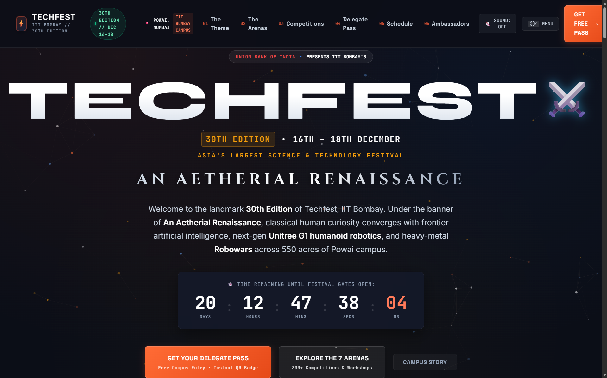

# IIT Bombay Techfest - Campus Ambassador Project 🤖

> **Live Deployment:** [ca-iitbtechfest.pages.dev](https://ideatelandingpage-ca-iitbtechfest.pages.dev/)

---

## ⚡ Techfest 30th Edition — An Aetherial Renaissance

Official landing page concept for **Techfest 30th Edition, IIT Bombay** ([techfest.org](https://techfest.org)) — Asia's Largest Science and Technology Festival, presented by **Union Bank of India** (December 16–18, 2026).

Engineered with **100% 2D visual craft** (strictly **zero 3D models or meshes**), featuring procedural 2D canvas particle physics, tactile Web Audio API feedback, an active countdown timer, interactive 30th edition arenas, and a physical-style delegate pass generator with instant high-resolution PNG download.

---

## 🎨 Design System & Color Tokens

| Design Token | Value | Purpose |
|---|---|---|
| `--bg-void` | `#0B0E17` | Deep Obsidian Base |
| `--bg-surface` | `#161B2E` | Frosted Card & Panel Surface |
| `--accent-flame` | `#FF5E3A` | Festival Flame & Kinetic Spark Accent |
| `--accent-cobalt` | `#3B82F6` | IIT Bombay Heritage Royal Cobalt |
| `--accent-sun` | `#F59E0B` | Trophy Gold & Sunlight Accent |
| `--accent-sage` | `#10B981` | Powai Campus Verdant Green & Status |
| `--font-renaissance` | `Cinzel` | Classical Renaissance Display Typography |
| `--font-heading` | `Syne` / `Space Grotesk` | Geometric Display & Headlines |

---

## 🌟 Key Features

1. **Organic 2D Stardust Canvas (`#cyber-canvas`)**:
   - Strictly 100% 2D canvas API — zero Three.js, WebGL 3D scenes, or 3D meshes.
   - Gently drifting warm particles that respond smoothly to cursor proximity and gentle click pulses.
2. **Active Countdown Timer HUD**:
   - Real-time countdown to the 30th Edition inauguration on **December 16, 2026 at 09:00 IST** with microsecond precision and dynamic rollover.
3. **The Seven 30th Edition Arenas**:
   - **International Robowars**: Heavyweight 60kg and 15kg combat championship inside the fortified arena.
   - **AI for Technology Readiness**: Global challenge partnered with **UN ESCAP** & **APCTT**.
   - **The India @ 71/100 Challenge**: National governance and civic innovation challenge.
   - **InnovateX**: Sustainable hardware and prototype engineering.
   - **Unitree G1 Humanoid Robot Demonstration**: Next-generation bipedal AI humanoid showcase.
   - **Union Bank International Summit**: Centerpiece summit featuring Nobel Laureates and ISRO Space Mission Directors.
   - **Technoholix & Ozone**: 500-drone aerial light ballet over Powai Lake, EDM concerts, and F1 motion simulators.
4. **Delegate Lanyard Pass Studio**:
   - Real-time custom attendee credentials with track selection and official QR code.
   - Instant **High-Resolution PNG Badge Export** rendered client-side via offscreen 2D canvas.
5. **Master 3-Day Schedule**:
   - Filterable hourly itineraries across Day 1 (*Genesis*), Day 2 (*Union Bank Summit & Humanoid Expo*), and Day 3 (*Robowars Finals & Drone Ballet*).
6. **Quick Navigator Palette (`Ctrl + K` / `⌘K`)**:
   - Keyboard-accessible navigation overlay to jump to any arena or event.

---

## 🚀 How to Run & Preview

Open `index.html` directly in any web browser (Chrome, Edge, Firefox, Brave, Safari). No build steps or server dependencies required.

---

## 📸 Preview

---

*Created as part of the IIT Bombay Techfest Campus Ambassador initiative.*
